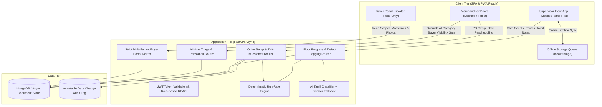
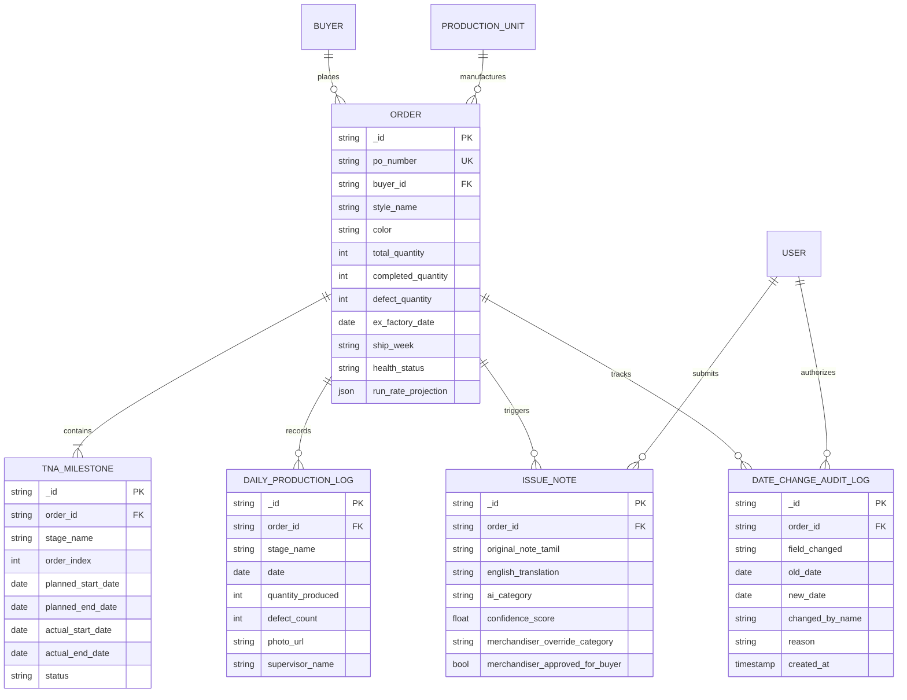
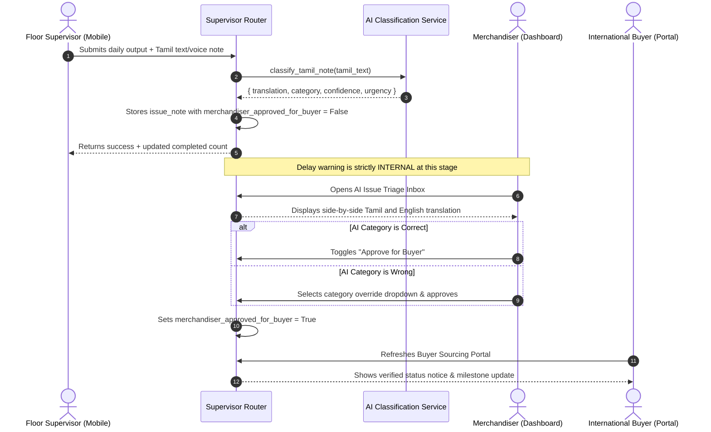

# Technical Design Document (TDD)
## TiruppurTex: Knitwear Exporter Production Order-Tracking & Delay Warning System

- **Candidate Role**: Software Engineering Intern
- **Problem Statement**: Problem 4 — Knitwear exporter's production order-tracking app with buyer view (Company A, Tiruppur)
- **GitHub Repository**: `https://github.com/dshukla/isocode-tiruppur-tex` *(Update with final repository URL)*
- **Live Deployment URL**: `https://tiruppur-tex.vercel.app` *(Frontend on Vercel, Backend on Render)*

---

## 1. Executive Summary & Business Objective

Company A is an export-oriented knitwear manufacturer based in Tiruppur, Tamil Nadu, supplying global retail buyers in the UK and European Union. Operating 3 owned manufacturing units along with subcontracted screen printing and washing facilities, the company generates ₹95–110 Crore annually across ~500 production orders (average order value ₹21 Lakhs).

### The Financial Bleed:
Company A loses **₹1.08 Crore annually** due to late order detection:
1. **Air Freight Emergencies**: 15 orders/year miss ocean vessel cutoffs, forcing air freight at ₹3.5 Lakh extra = **₹52.5 Lakhs**.
2. **Buyer Discount Concessions**: 25 orders/year incur contractual 5% late penalties (25 × ₹1.05L) = **₹26.25 Lakhs**.
3. **Merchandiser Firefighting**: 12 merchandisers spend 2 hours daily chasing status via phone calls and fragmented Excel sheets = 7,200 hours/year × ₹400 = **₹28.8 Lakhs**.

### System Goal:
Transform status tracking from reactive firefighting (discovering delays 2 days before shipment) into proactive, mathematical run-rate forecasting that surfaces warnings **two weeks in advance**. Supervisors report real shift numbers from the floor in Tamil, the system calculates output velocity against remaining workdays, and buyers receive transparent milestone updates without emailing the factory.

---

## 2. System Architecture & Technology Justification

### Why This Tech Stack Was Chosen:

| Layer | Selected Tech | Justification & Architectural Trade-Offs |
| :--- | :--- | :--- |
| **Frontend** | React 18 + Vite | Sub-second build times, tiny JavaScript bundle (~114 kB gzip) optimal for low-end Android phones (2–3 GB RAM). Client-side routing delivers a responsive desktop dashboard for merchandisers. |
| **Styling** | Tailwind CSS | Utility-first styling enforces consistent spacing, typography, and a restrained color palette without bulky UI component libraries. |
| **Backend** | Python 3.13 + FastAPI | Asynchronous event loop (`async`/`await`) easily handles concurrent floor updates from mobile devices; Pydantic v2 guarantees strict type safety; native Python date handling simplifies working-calendar algorithms. |
| **Database** | MongoDB | Document-oriented model mirrors knitwear order hierarchies (order $\rightarrow$ size matrix $\rightarrow$ TNA milestones $\rightarrow$ daily floor logs) without requiring complex relational joins. An embedded zero-config engine enables instant local testing without database daemons. |
| **Authentication** | JWT + RBAC | Stateless, tamper-proof bearer tokens embed user identity, role, and tenant IDs (`buyer_id`, `unit_id`), enforcing access boundaries at the router level. |
| **AI Classification** | Google Gemini / OpenAI + Local Lexicon | Structured JSON output extracts standardized reason categories and confidence scores from Tamil voice/text notes. A deterministic local textile lexicon ensures 100% uptime when offline or when API limits occur. |

---

## 3. Data Model & Database Schemas

### Entity-Relationship Diagram:

---

## 4. Core Mathematical Engine: Run-Rate Delay Projection

The system replaces guesswork with a transparent mathematical derivation:

### 1. Working Days Calculation:
Tiruppur factories operate Monday through Saturday (Sunday off). Working days between current date ($D_{\text{today}}$) and target ex-factory date minus a 2-day customs buffer ($D_{\text{target}}$) are calculated as:
$$\text{Workdays Left} = \sum_{d = D_{\text{today}} + 1}^{D_{\text{target}}} \mathbb{I}(\text{weekday}(d) \neq \text{Sunday})$$

### 2. Required Run-Rate:
$$\text{Pieces Needed / Day} = \frac{\text{Total Quantity} - \text{Completed Quantity}}{\max(1, \text{Workdays Left})}$$

### 3. Actual Floor Velocity:
$$\text{Pieces Made / Day} = \frac{1}{K} \sum_{i=1}^{K} \text{Daily Output}_i \quad (K \in [3, 5] \text{ recent shift entries in current stage})$$

### 4. Projected Delay & Status Rules:
$$\text{Days Needed} = \left\lceil \frac{\text{Remaining Pieces}}{\max(1, \text{Pieces Made / Day})} \right\rceil$$
$$\text{Projected Completion Date} = D_{\text{today}} + \text{AddWorkdays}(\text{Days Needed})$$
$$\text{Delay Days} = \max(0, \text{Projected Completion Date} - D_{\text{ex-factory}})$$

- **GREEN (On Track)**: $\text{Delay Days} = 0$ AND $\frac{\text{Pieces Made}}{\text{Pieces Needed}} \ge 0.85$.
- **AMBER (Actionable Warning)**: $1 \le \text{Delay Days} \le 4$ OR $0.60 \le \frac{\text{Pieces Made}}{\text{Pieces Needed}} < 0.85$.
- **RED (Critical Risk)**: $\text{Delay Days} > 4$ OR $\frac{\text{Pieces Made}}{\text{Pieces Needed}} < 0.60$.
  - Triggers **₹3.5 Lakh air freight penalty warning** when delay $\ge 6$ days.
  - Triggers **₹1.05 Lakh buyer 5% discount warning** when delay is 2–5 days.

---

## 5. AI Flow & Human-in-the-Loop Safeguards

### AI Failure Modes & Resilience:
1. **Network or LLM API Outage**: Seamlessly switches to the local Tiruppur textile domain lexicon, parsing domain keywords (*தையல் மெஷின், நூல் வரத்து, பிரிண்டிங் மை கசிவு*) with 0 ms external latency.
2. **Low Confidence Scores**: Issues with confidence $< 0.70$ are highlighted with amber review badges for merchandiser verification.
3. **Buyer Protection Gate**: Unverified or incorrect AI outputs never reach buyers directly.

---

## 6. UI & Design Decisions

### Design Principles:
- **Restrained Palette & Purposeful Whitespace**: Clean neutral slate canvas with high-contrast emerald (on-track), amber (warning), and crimson (critical) accents.
- **Shop Floor Usability**: Mobile supervisor screen features high touch targets, large keypad numeric inputs, one-click camera capture, and an instant **Tamil / English** toggle.
- **Merchandiser Efficiency**: Dense data grid displaying PO, style, color, current stage, completed quantity percentage, ship week, and direct action triggers for the Run-Rate Math modal and Compliance Date Change modal.

---

## 7. Assumptions Labeled

1. **[ASSUMPTION-CALENDAR]**: Tiruppur manufacturing units work a 6-day week (Monday to Saturday); Sunday is non-working.
2. **[ASSUMPTION-BUFFER]**: A standard 2-day buffer is reserved before the contractual ex-factory date for inland transport and port customs processing.
3. **[ASSUMPTION-FINANCIALS]**: Air freight penalty surcharge is fixed at ₹3.5 Lakhs per order; late delivery discount concession is 5% on an average order value of ₹21 Lakhs (₹1.05 Lakhs).
4. **[ASSUMPTION-STAGES]**: Standard knitwear TNA lead times follow a 28-day backward schedule from ex-factory date across 7 core production stages.

---

## 8. What Was Cut & Future Roadmap

### Features Cut from Current Scope:
- **Yarn & Fabric Raw Material Inventory**: Excluded per problem statement out-of-scope guidelines.
- **Biometric Worker Attendance & Payroll**: Excluded per guidelines.
- **Commercial Invoicing & Customs Documents**: Excluded per guidelines.

### Future Roadmap:
1. **Automated WhatsApp Alerts**: Direct dispatch of Amber/Red alerts to shift supervisors via WhatsApp Business API.
2. **Subcontractor Live Portal**: Dedicated subcontractor login for external printing and washing units to log lot dispatch directly.
3. **RFID Bundle Tracking**: Integration with RFID garment bundle tags for automatic scanning at sewing line entry and exit.

