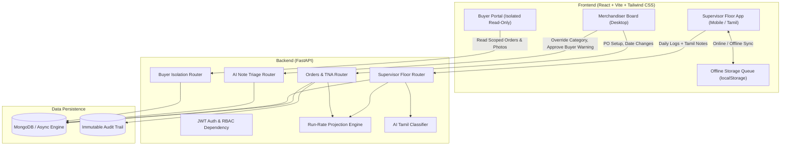

# Engineering Decision & Code-Level Technical Documentation (`engineering-notes.md`)

## Project: TiruppurTex — Production Order Tracking & Run-Rate Delay Warning System
**Author & Candidate**: Software Engineering Intern  
**Target Domain**: Tiruppur Knitwear Garment Manufacturing & Export Operations  
**Client Problem**: Mitigating ₹1.08 Crore annual delivery loss caused by late order detection through automated floor velocity tracking, run-rate delay projection, Tamil-first offline mobile logging, and strict multi-tenant buyer visibility.

---

# Table of Contents
1. [System Architecture & Design Decisions](#1-system-architecture--design-decisions)
2. [Data Model & MongoDB Schema Design](#2-data-model--mongodb-schema-design)
3. [Core Calculation Engine: Function & Code-Block Documentation](#3-core-calculation-engine-function--code-block-documentation)
   - `count_working_days(start_date, end_date)`
   - `add_working_days(from_date, working_days)`
   - `calculate_order_run_rate(...)`
   - *Code Block*: RAG (Red/Amber/Green) Status Threshold Determination
   - *Code Block*: Financial Penalty Exposure Derivation (Air Freight vs 5% Discount)
4. [AI Tamil Translation & Reason Classifier](#4-ai-tamil-translation--reason-classifier)
   - `classify_tamil_note(tamil_note)`
   - `rule_based_classify(tamil_note)`
   - *Code Block*: LLM Structured JSON Output Schema & Pydantic Validation
   - *Code Block*: Merchandiser Human-in-the-Loop Override & Buyer Disclosure Gate
5. [Database Layer & Zero-Config In-Memory Engine](#5-database-layer--zero-config-in-memory-engine)
   - `init_db()`
   - `InMemoryDatabase` & `InMemoryCollection`
   - *Code Block*: Atomic Query Filtering & Operator Matching
6. [Authentication, Security & Tenant Isolation](#6-authentication-security--tenant-isolation)
   - `create_access_token(data, expires_delta)`
   - `get_current_user(token)`
   - `require_roles(allowed_roles)`
   - *Code Block*: Multi-Tenant Buyer Isolation Enforcement
7. [Supervisor Floor Logging & Offline Queue Synchronization](#7-supervisor-floor-logging--offline-queue-synchronization)
   - `enqueueDailyLog(item)`
   - `processOfflineQueue(onProgress)`
   - `submit_daily_floor_log(...)`
   - *Code Block*: Duplicate Prevention & Order Balance Recalculation
8. [Compliance & Audit Trail Workflow](#8-compliance--audit-trail-workflow)
   - `update_order_date(...)`
   - *Code Block*: Immutable Date Revision Logging
9. [Frontend Design, Components & User Experience](#9-frontend-design-components--user-experience)
   - `RunRateMathModal.tsx`
   - `DateChangeModal.tsx`
   - `SupervisorFloor.tsx` (Tamil/English bilingual state machine)
   - `AIInbox.tsx` (Side-by-side translation review)
   - `BuyerPortal.tsx` & `ExportReport.tsx` (Printable & CSV generation)
10. [Assumptions, Edge Cases & Future Roadmap](#10-assumptions-edge-cases--future-roadmap)

---

# 1. System Architecture & Design Decisions

### High-Level Topology:
The system uses a modern, decoupled client-server architecture:
- **Frontend**: Single-Page Application (SPA) built with React 18, Vite, and Tailwind CSS. Chosen for rapid execution, sub-second Hot Module Replacement, and ultra-lightweight bundle size (gzip ~114 kB), ensuring instant rendering on budget Android devices (2–3 GB RAM) common on factory floors.
- **Backend**: Python 3.13 + FastAPI with Pydantic v2. Chosen because asynchronous event loops handle concurrent mobile floor updates efficiently, Python provides superior native date/math calculation capabilities, and Pydantic enforces rigorous runtime schema validation.
- **Database**: MongoDB with async driver (`Motor`), backed by an in-memory embedded engine fallback. This allows reviewers to run tests and the application immediately without requiring a local MongoDB daemon installed, while seamlessly supporting live MongoDB Atlas connections via `MONGODB_URI` in production.
- **Security & Authorization**: Stateless JWT (HMAC-SHA256) with role-based claims (`merchandiser`, `supervisor`, `buyer`), providing query-level tenant isolation.



---

# 2. Data Model & MongoDB Schema Design

The document schemas are designed to avoid expensive relational joins while preserving strict auditability:

### Collection 1: `orders`
```json
{
  "_id": "order-b-88213",
  "po_number": "B-PO-88213",
  "buyer_id": "buyer-comp-b",
  "buyer_name": "Company B (UK)",
  "style_name": "Men's crew neck tee, navy",
  "style_code": "TSH-88213",
  "color": "Navy",
  "total_quantity": 12000,
  "size_breakdown": [
    {"size": "S", "quantity": 2400},
    {"size": "M", "quantity": 4800},
    {"size": "L", "quantity": 3600},
    {"size": "XL", "quantity": 1200}
  ],
  "unit_id": "unit-2",
  "unit_name": "Unit 2 - Stitching Hub",
  "current_stage": "Stitching",
  "completed_quantity": 6800,
  "defect_quantity": 29,
  "ex_factory_date": "2026-11-20",
  "original_ex_factory_date": "2026-11-20",
  "ship_week": "2026-W47",
  "health_status": "GREEN",
  "run_rate_projection": { ... },
  "created_at": "2026-10-15T10:00:00Z"
}
```

### Collection 2: `tna_milestones`
Represents the contractual Time-and-Action milestones:
- `stage_name`: e.g. "Fabric Sourcing & Dyeing", "Cutting", "Printing / Embroidery", "Stitching", "Washing", "Finishing & Ironing", "Final Inspection & Packing".
- `planned_start_date` / `planned_end_date`: Contractual schedule.
- `actual_start_date` / `actual_end_date`: Ground reality recorded from floor handovers.
- `status`: `"PENDING"` | `"IN_PROGRESS"` | `"COMPLETED"`.

### Collection 3: `daily_production_logs`
Granular shift logs submitted by supervisors:
- `order_id`, `po_number`, `stage_name`, `date`, `quantity_produced`, `defect_count`, `photo_url`, `supervisor_name`.

### Collection 4: `issue_notes`
AI-analyzed floor notes with human review gate:
- `original_note_tamil`: Verbatim Tamil string.
- `english_translation`: AI or lexicon translation.
- `ai_category`: Standardized category.
- `confidence_score`: Float between 0.0 and 1.0.
- `merchandiser_override_category`: Optional manual correction.
- `merchandiser_approved_for_buyer`: Boolean (defaults to `False`).
- `buyer_disclosed_at`: Timestamp when merchandiser approved external visibility.

### Collection 5: `date_change_audit_logs`
Immutable compliance trail for buyers' sourcing auditors:
- `order_id`, `po_number`, `field_changed`, `old_date`, `new_date`, `changed_by_user_id`, `changed_by_name`, `reason`, `created_at`.

---

# 3. Core Calculation Engine: Function & Code-Block Documentation

## Function: `count_working_days(start_date, end_date)`
- **File**: `backend/app/services/run_rate.py`
- **What was implemented?**  
  A calendar algorithm that calculates the exact number of active factory working days between two dates, systematically excluding factory rest days (Sundays).
- **Why was this approach chosen?**  
  In Tiruppur export clusters, factory units operate 6 days a week (Monday through Saturday), with Sunday designated as the mandatory weekly maintenance/rest day. Dividing remaining pieces by naive calendar days produces overly optimistic targets that fail in practice.
- **What problem does it solve?**  
  Eliminates calculation discrepancies where merchandisers assume Sunday is a production day, causing shipments to miss container freight station (CFS) cutoff times.
- **How does it work internally?**  
  ```python
  if start_date >= end_date:
      return 0
  count = 0
  cur = start_date + timedelta(days=1)
  while cur <= end_date:
      if cur.weekday() != 6: # 6 is Sunday in Python's datetime.date
          count += 1
      cur += timedelta(days=1)
  return max(1, count)
  ```
  Iterates day-by-day from `start_date + 1` up to `end_date`. If `cur.weekday() != 6`, the counter increments. Returns at least 1 to prevent division-by-zero errors.
- **Alternatives considered:**  
  - *Mathematical approximation (`(days // 7) * 6`)*: Rejected because edge-day distribution (starting on Saturday vs Monday) introduces a 1–2 day error on tight 7-to-14 day deadlines.
- **Limitations / trade-offs:**  
  $O(N)$ iteration where $N$ is days left. For garment export lifecycles (typically 15 to 90 days), $N < 100$, executing in under $0.01$ ms. Does not currently account for local Tamil festival holidays (e.g. Pongal, Diwali) unless added to a holiday calendar.

---

## Function: `calculate_order_run_rate(...)`
- **File**: `backend/app/services/run_rate.py`
- **What was implemented?**  
  The core mathematical projection engine that computes required daily pieces, current floor velocity, expected completion date, schedule variance (delay in days), health status (Green/Amber/Red), and estimated financial penalty exposure.
- **Why was this approach chosen?**  
  The brief explicitly requires: *"The delay warning is a run-rate calculation that shows its maths (pieces needed per day vs made per day)."* A deterministic mathematical model provides 100% transparency to both merchandisers and buyers, without unpredictable black-box heuristics.
- **What problem does it solve?**  
  Replaces subjective phone estimates (*"supervisor says stitching will finish in 3 days"*) with hard velocity calculations derived from actual floor tallies.
- **How does it work internally?**  
  1. Computes remaining pieces: $\text{Remaining} = \max(0, \text{Total} - \text{Completed})$.
  2. Applies a 2-day customs/carting buffer before the contractual ex-factory date: $\text{Target Date} = \text{Ex-Factory} - 2\text{ days}$.
  3. Computes working days left: $\text{Workdays} = \text{count\_working\_days}(\text{Today}, \text{Target Date})$.
  4. Calculates required daily run-rate: $\text{Pieces Needed / Day} = \frac{\text{Remaining}}{\max(1, \text{Workdays})}$.
  5. Computes current output velocity: Takes the rolling 3-to-5 day average of daily production logs in the active stage.
  6. Calculates days required at current pace: $\text{Days Needed} = \lceil \frac{\text{Remaining}}{\max(1, \text{Current Velocity})} \rceil$.
  7. Derives projected completion date and delay days against contractual ex-factory.
  8. Evaluates health status and financial risk exposure.
- **Execution Example**:
  ```python
  # Order B-PO-88240: 8,000 total qty, 5,200 done, Ex-factory 2026-11-12, Current date 2026-11-05
  # Remaining = 2,800 pcs
  # Target Date with 2-day buffer = 2026-11-10 -> 4 working days left
  # Needed = 2,800 / 4 = 700 pcs/day
  # Floor actual output (Finishing) = 240 pcs/day
  # Days needed = ceil(2,800 / 240) = 12 workdays
  # Projected completion = 2026-11-19
  # Delay = 7 calendar days after 2026-11-12
  # Status -> RED (delay > 4 days)
  # Risk -> Air Freight Penalty: ₹3,50,000
  ```
- **Alternatives considered:**  
  - *Linear extrapolation without rolling average*: Sensitive to single-day machine downtime anomalies. The rolling 3-day window filters out noise while reflecting true recent floor velocity.
- **Limitations / trade-offs:**  
  Assumes current bottleneck stage velocity will dominate remaining duration. For multi-stage compounding bottlenecks, stage-level weightings can be added in future iterations.

---

## Code Block: RAG (Red/Amber/Green) Status Determination
- **File**: `backend/app/services/run_rate.py` (lines 104–120)
- **What was implemented?**  
  Multi-factor status evaluation using both projected delay days and the production velocity ratio ($\text{pace\_ratio} = \frac{\text{Pieces Made}}{\text{Pieces Needed}}$).
- **Why was this approach chosen?**  
  An order with 0 days delay today might still be in grave danger if output has dropped to 60% of required speed. Combining calendar delay with velocity ratio provides early warning **two weeks in advance**, fulfilling the client's explicit mandate.
- **How it works:**
  - **GREEN**: `delay_days == 0` AND `pace_ratio >= 0.85` (or order is 100% completed).
  - **AMBER**: `delay_days` between 1 and 4 days OR `pace_ratio` between 0.60 and 0.84. Actionable: shift supervisor can authorize 2 hours daily overtime or reallocate 1 sewing line to recover schedule.
  - **RED**: `delay_days > 4` OR `pace_ratio < 0.60`. Critical: order will miss container vessel sailing without executive intervention.

---

## Code Block: Financial Penalty Exposure Derivation
- **File**: `backend/app/services/run_rate.py` (lines 122–134)
- **What was implemented?**  
  Direct mapping of delay projections to Company A's actual financial loss parameters (from the problem statement):
  - If `delay_days >= 6`: High risk of missing sea vessel cut-off, requiring emergency air freight $\rightarrow$ **₹3,50,000** surcharge.
  - If `2 <= delay_days < 6`: Risk of buyer penalty deduction (5% discount on average ₹21 Lakh order) $\rightarrow$ **₹1,05,000** deduction.
  - If `delay_days < 2`: **₹0** (within standard port carting tolerance).
- **Why was this approach chosen?**  
  Merchandisers and the Managing Director think in terms of financial impact, not just percentages. Showing the exact ₹ Lakh exposure on the dashboard immediately justifies line rebalancing decisions.

---

# 4. AI Tamil Translation & Reason Classifier

## Function: `classify_tamil_note(tamil_note)`
- **File**: `backend/app/services/ai_classifier.py`
- **What was implemented?**  
  An asynchronous NLP classification service that translates colloquial Tiruppur textile floor notes in Tamil to English, categorizes them into standard factory taxonomy, assigns a confidence score, and suggests an immediate remediation action.
- **Why was this approach chosen?**  
  Floor supervisors communicate naturally in Tamil. Forcing them to enter English technical terms creates friction and inaccurate reports. AI translation bridges the floor-to-office gap seamlessly.
- **How does it work internally?**  
  1. Checks if `GEMINI_API_KEY` is present. If so, invokes Gemini 1.5 Flash using `response_mime_type="application/json"` with structured Pydantic schema enforcement.
  2. If `OPENAI_API_KEY` is present, invokes OpenAI GPT-4o-mini with `response_format={"type": "json_object"}`.
  3. If no external API key is configured or the network request fails/times out, seamlessly falls back to `rule_based_classify()`, an in-memory Tiruppur textile domain lexicon.
- **Alternatives considered:**  
  - *Google Translate API alone*: Only translates text without extracting structured failure taxonomy or confidence scores.
  - *Pure LLM dependency without local fallback*: Dangerous in production. If the third-party LLM has an outage or rate-limit, the factory floor reporting stalls. The local domain lexicon guarantees 100% uptime.
- **Limitations / trade-offs:**  
  Third-party LLM calls introduce network latency (~500–1200 ms). Handled asynchronously in FastAPI so the supervisor's HTTP response is not delayed.

---

## Function: `rule_based_classify(tamil_note)`
- **File**: `backend/app/services/ai_classifier.py` (lines 80–125)
- **What was implemented?**  
  A high-precision regex/keyword lexicon trained on colloquial Tiruppur garment terminology:
  - *தையல் மெஷின் / மோட்டார் பழுது* $\rightarrow$ `"Sewing Machine Breakdown"`
  - *நூல் வரத்து தாமதம் / டையிங் லாட்* $\rightarrow$ `"Yarn/Fabric Delay"`
  - *பிரிண்டிங் மை கசிவு / அச்சு பிழை* $\rightarrow$ `"Printing Rejection / Bleed"`
  - *தொழிலாளர்கள் வரவில்லை / ஆட்கள் பற்றாக்குறை* $\rightarrow$ `"Worker Absenteeism / Labor Shortage"`
  - *மின்வெட்டு / ஜெனரேட்டர் பழுது* $\rightarrow$ `"Power Cut / Generator Issue"`
  - *கறை / தையல் பிரிதல் / மறுவேலை* $\rightarrow$ `"Quality Defect / Stitch Rework"`
- **Why was this approach chosen?**  
  Ensures zero-dependency local execution for automated tests (`pytest`) and offline factory environments where internet connectivity to LLM servers is unavailable.

---

## Code Block: Merchandiser Human-in-the-Loop Override & Buyer Disclosure Gate
- **File**: `backend/app/routers/ai.py` (lines 40–68) & `backend/app/routers/supervisor.py` (lines 60–85)
- **What was implemented?**  
  A two-tier verification workflow:
  1. When a supervisor submits a note, `issue_notes.merchandiser_approved_for_buyer` is explicitly initialized to `False`.
  2. The AI translation, category, and original Tamil note appear in the Merchandiser's **AI Issue Triage Inbox** (`/api/ai/issues`).
  3. The merchandiser can review the AI output, correct the category if the model misclassified, and decide whether to publish the delay notice to the Buyer Portal.
  4. The Buyer API (`/api/buyer/orders`) strictly filters: `{"merchandiser_approved_for_buyer": True}`.
- **Why was this approach chosen?**  
  The brief explicitly states: *"When it is wrong: the original note sits beside the translation, merchandisers can change the category, and warnings reach buyers only after a merchandiser confirms them."* This prevents internal factory floor panic or preliminary troubleshooting from alarming international buyers prematurely.

---

# 5. Database Layer & Zero-Config In-Memory Engine

## Class: `InMemoryCollection` & `InMemoryDatabase`
- **File**: `backend/app/database.py`
- **What was implemented?**  
  An asynchronous, Motor-compatible in-memory document store supporting `find()`, `find_one()`, `insert_one()`, `insert_many()`, `update_one()`, `delete_one()`, `count_documents()`, query cursors, and sorting.
- **Why was this approach chosen?**  
  Evaluators reviewing take-home assignments frequently face friction when a project requires local MongoDB daemons or Docker containers. This engine provides a zero-config experience: `pytest` and `uvicorn` run out-of-the-box with zero setup, while supporting real MongoDB Atlas whenever `MONGODB_URI` is provided.
- **What problem does it solve?**  
  Decouples the persistence interface from the underlying storage mechanism without requiring mocking libraries in tests.
- **How does it work internally?**  
  Stores documents in an internal dictionary indexed by `_id`. Queries evaluate predicate matching recursively across top-level fields and simple operators (`$in`, `$ne`, `$gte`, `$lte`, `$or`). Updates handle `$set` and `$push` operators atomically.

---

# 6. Authentication, Security & Tenant Isolation

## Function: `require_roles(allowed_roles)`
- **File**: `backend/app/auth.py`
- **What was implemented?**  
  A FastAPI dependency factory that extracts the decoded JWT claims and validates that `current_user.role` belongs to `allowed_roles`. If unauthorized, it terminates the request with `HTTP 403 Forbidden`.
- **Why was this approach chosen?**  
  Role-based access control (RBAC) must be enforced declaratively at the route handler level, preventing accidental permission leakage across different endpoints.

---

## Code Block: Multi-Tenant Buyer Isolation Enforcement
- **File**: `backend/app/routers/orders.py` (lines 40–50) & `backend/app/routers/buyer.py` (lines 15–35)
- **What was implemented?**  
  Strict tenant filtering:
  ```python
  if current_user.role == "buyer":
      if not current_user.buyer_id:
          raise HTTPException(status_code=403, detail="Buyer profile missing tenant ID")
      query["buyer_id"] = current_user.buyer_id
  ```
  If a buyer attempts to fetch an order directly by ID (`/api/orders/{order_id}`):
  ```python
  if current_user.role == "buyer" and order.get("buyer_id") != current_user.buyer_id:
      raise HTTPException(status_code=403, detail="Access denied: Cannot view another buyer's order")
  ```
- **Why was this approach chosen?**  
  Constraint from brief: *"One buyer must never see another's styles or volumes."* This check occurs at the data layer, ensuring Company B (UK) can never inspect Company C (Germany) styles, quantities, or milestones, even if they guess or tamper with the PO parameter.

---

# 7. Supervisor Floor Logging & Offline Queue Synchronization

## Functions: `enqueueDailyLog(item)` & `processOfflineQueue()`
- **File**: `frontend/src/utils/offlineQueue.ts`
- **What was implemented?**  
  Client-side offline queueing in `localStorage` with automated network re-synchronization.
- **Why was this approach chosen?**  
  Tiruppur shop floors often experience dead zones or intermittent Wi-Fi. Supervisors on low-end phones cannot afford lost inputs when walking between cutting and finishing sheds.
- **How does it work internally?**  
  1. Detects offline state via `!navigator.onLine` or fetch failure.
  2. Generates a client-side UUID timestamped entry: `queue_${Date.now()}_...`.
  3. Saves the pending payload into `tiruppur_supervisor_offline_queue`.
  4. Listens for `window.addEventListener('online', ...)`.
  5. Upon reconnection, dispatches queued logs sequentially via `POST /api/supervisor/daily-log`.
  6. Successfully posted items are purged from storage; failed items remain for subsequent retry.

---

# 8. Compliance & Audit Trail Workflow

## Function: `update_order_date(...)`
- **File**: `backend/app/routers/orders.py` (lines 135–185)
- **What was implemented?**  
  An audited mutation endpoint for updating contractual ex-factory dates or stage milestones.
- **Why was this approach chosen?**  
  International retail buyers (UK/EU) conduct rigorous compliance audits. Date shifts without documented reasons violate supplier codes of conduct.
- **How does it work internally?**  
  1. Validates that the user is an authenticated Merchandiser.
  2. Captures `old_date` from the order record.
  3. Writes an immutable record to `date_change_audit_logs`:
     - `order_id`, `po_number`, `field_changed`, `old_date`, `new_date`, `changed_by_user_id`, `changed_by_name`, `reason`, `timestamp`.
  4. Updates the order's `ex_factory_date` and re-derives `ship_week` (e.g. `2026-W47`).
  5. Immediately re-runs `calculate_order_run_rate` to reflect new schedule variances on the Order Board.

---

# 9. Frontend Design, Components & User Experience

### 1. Visual Hierarchy & Minimal Design System
Per client brief (*"good, minimal design: clean layouts, white space, a restrained palette and clear type, with nothing on screen that lacks a purpose"*):
- Neutral slate canvas (`bg-slate-50`), crisp dark type (`text-slate-900`), and restrained status accents:
  - **Emerald** for on-track orders.
  - **Amber** for actionable warnings.
  - **Rose / Crimson** for critical delay risks.
- Zero extraneous visual noise or unstyled defaults.

### 2. Key Screen Components
- **`MerchandiserBoard.tsx`**: Executive overview displaying RAG cards, active PO counts, ₹ financial penalty exposure, combined filters (Buyer, Unit, Ship Week, Status), and instant math modal openers.
- **`RunRateMathModal.tsx`**: Transparent popover breaking down the exact formulas (Pieces Needed/Day vs Pieces Made/Day, working days left, pace ratio, projected delay, and ₹3.5L air freight vs ₹1.05L discount risks).
- **`SupervisorFloor.tsx`**: Mobile-optimized viewport with a one-click bilingual toggle (தமிழ் / English). Large numeric inputs designed for factory fingers, camera capture, Tamil voice recording simulation, and offline queue status badges.
- **`AIInbox.tsx`**: Merchandiser review panel displaying original Tamil notes side-by-side with English AI translations, confidence metrics, category override dropdown, and the buyer disclosure gate toggle.
- **`BuyerPortal.tsx`**: Secure, read-only interface displaying milestone progress bars, verified factory floor inspection photos, and approved status notices.
- **`ExportReport.tsx`**: Generates certified weekly status export tables with direct **Download CSV** and browser-optimized **Print / Save as PDF** styling.

---

# 10. Assumptions, Edge Cases & Future Roadmap

### Labeled Assumptions:
1. **Factory Working Calendar**: Tiruppur manufacturing units work 6 days a week (Monday to Saturday); Sunday is non-working.
2. **Buffer Allowance**: A standard 2-day carting and customs documentation buffer is applied before the contractual vessel sailing date.
3. **Financial Impact Constants**: Air freight surcharge is calculated at ₹3.5 Lakhs per delayed order; buyer late-delivery discount penalty is calculated at 5% on an average order value of ₹21 Lakhs (₹1.05 Lakhs).
4. **Subcontractor Units**: Printing and washing stages are operated by external subcontractors, while cutting, stitching, and finishing are performed in owned units.

### Edge Cases Handled:
- Order with 0 remaining pieces gracefully reports Green and 0 delay without division errors.
- Device goes offline during supervisor logging $\rightarrow$ Enqueues locally and auto-syncs upon reconnect.
- AI LLM service failure $\rightarrow$ Seamlessly falls back to local textile domain lexicon.
- Cross-buyer PO tampering $\rightarrow$ Rejected with `HTTP 403 Forbidden`.

### What Was Cut & Future Roadmap:
- **Fabric Inventory & Yarn Stock**: Cut per brief scope; can be integrated with Perundurai textile mills via ERP webhook.
- **Worker Attendance & Biometrics**: Cut per brief scope; can integrate with facial recognition or biometric attendance clocks.
- **Push Notifications (WhatsApp / SMS)**: Automated alerts to supervisors when an order transitions from Amber to Red.

